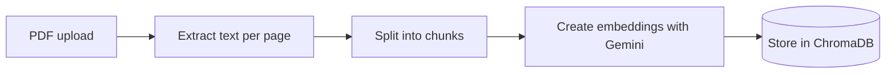
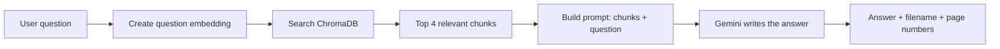
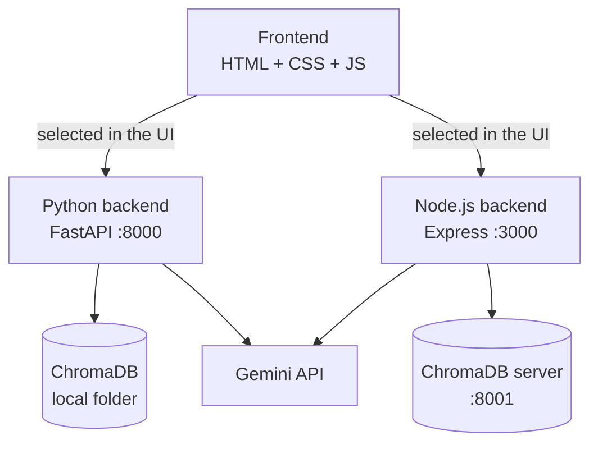

# DocMind AI - Chat with your documents

DocMind AI lets you upload PDFs and ask questions about them. The answer is written by Google Gemini, but only from the parts of your PDFs that are related to the question. Every answer shows the **file name and page number** it came from.

It is built for the MLSA **Build with RAG** workshop, so the code is kept small and heavily commented.

The same app is built **twice**, so you can compare:

| | Python backend | JavaScript backend |
|---|---|---|
| Server | FastAPI | Express |
| PDF reading | PyMuPDF | pdf-parse |
| Vector database | ChromaDB | ChromaDB |
| AI | Google Gemini | Google Gemini |
| Port | 8000 | 3000 |

One common frontend (plain HTML, CSS, JavaScript) works with both.

---

## What is RAG?

A language model like Gemini does not know what is inside **your** PDF. We could paste the whole PDF into every question, but that is slow, expensive, and large PDFs do not fit.

**RAG (Retrieval-Augmented Generation)** fixes this in three steps:

1. **Retrieval** - search your documents and pick only the few pieces related to the question.
2. **Augmented** - add those pieces to the prompt.
3. **Generation** - Gemini writes the answer using only those pieces.

Key words:

- **Chunk** - a small piece of text (about 800 characters). Small pieces make the search precise.
- **Embedding** - a list of numbers that represents the *meaning* of a text. Similar meaning gives similar numbers.
- **Vector database (ChromaDB)** - stores chunks with their embeddings and can quickly find the closest ones to a question.

---

## How DocMind AI works

### A. Upload a PDF (ingestion)



### B. Ask a question



### Architecture



The two backends never talk to each other. Each one does the full RAG pipeline on its own.

---

## Folder structure

```
docmind-ai/
├── frontend/
│   ├── index.html        page structure
│   ├── style.css         dark theme
│   └── script.js         upload, chat, backend switch (calls the API with fetch)
├── python-backend/
│   ├── main.py           FastAPI server and API endpoints
│   ├── pdf.py            reads PDF text page by page
│   ├── rag.py            chunking, embeddings, prompt, Gemini
│   ├── database.py       ChromaDB: store, search, list, delete
│   ├── requirements.txt
│   └── .env.example
├── js-backend/
│   ├── server.js         Express server and API endpoints
│   ├── pdf.js
│   ├── rag.js
│   ├── database.js
│   ├── package.json
│   └── .env.example
├── sample-pdfs/          put any PDF here for testing (a syllabus works great)
├── README.md
└── .gitignore
```

---

## API (same in both backends)

| Method | Endpoint | What it does |
|---|---|---|
| GET | `/api/health` | Is the server running? |
| POST | `/api/documents/upload` | Upload a PDF (form field name: `file`) |
| GET | `/api/documents` | List uploaded documents |
| POST | `/api/chat` | Body: `{ "question": "..." }` returns the answer and sources |
| DELETE | `/api/documents/:id` | Delete a document and its vectors |

Success responses have `"success": true`. Errors look like `{ "success": false, "error": "message" }`.

---

## Prerequisites

- Python 3.10 or newer: https://www.python.org/downloads/ (tick **Add Python to PATH** during install)
- Node.js 20 or newer (LTS): https://nodejs.org
- A Gemini API key (free): https://aistudio.google.com/apikey

Check your versions in PowerShell:

```powershell
python --version
node --version
npm --version
```

## Gemini API key setup

1. Open https://aistudio.google.com/apikey and sign in with a Google account.
2. Click **Create API key** and copy it.
3. You will paste it into a `.env` file below. Never put it in the frontend and never upload `.env` to GitHub.

## ChromaDB setup

- **Python backend:** nothing to do. ChromaDB is installed with `pip` and saves its data in `python-backend/chroma_data`.
- **JavaScript backend:** the JavaScript ChromaDB package is only a client, so it needs a ChromaDB **server** running. You start it with one command (see below). Its data is saved in `js-backend/chroma_data`.

---

## Run the Python backend

```powershell
cd docmind-ai\python-backend
python -m venv .venv
.\.venv\Scripts\Activate.ps1
pip install -r requirements.txt
Copy-Item .env.example .env
notepad .env
```

Replace `your_gemini_api_key_here` with your key, save, then:

```powershell
uvicorn main:app --reload --port 8000
```

Open http://localhost:8000/api/health - you should see `"status": "ok"`.

If PowerShell refuses to activate the virtual environment, run this once and try again:

```powershell
Set-ExecutionPolicy -Scope Process -ExecutionPolicy Bypass
```

## Run the JavaScript backend

You need **two** terminals.

**Terminal 1 - ChromaDB server** (uses the Python package, so install it in a virtual environment):

```powershell
cd docmind-ai\js-backend
python -m venv .chroma-venv
.\.chroma-venv\Scripts\Activate.ps1
pip install chromadb
chroma run --path .\chroma_data --port 8001
```

Leave it running.

**Terminal 2 - Node.js server:**

```powershell
cd docmind-ai\js-backend
npm install
Copy-Item .env.example .env
notepad .env
npm start
```

Open http://localhost:3000/api/health - you should see `"status": "ok"`.

## Run the frontend

Open a new terminal:

```powershell
cd docmind-ai\frontend
python -m http.server 5500
```

Open http://localhost:5500 in your browser.

## Switch between backends

Use the **Python / JavaScript** switch at the top of the sidebar. The dot below it shows whether the selected server is online. The backend URLs are at the top of `frontend/script.js`:

```javascript
const BACKEND_URLS = {
  python: "http://localhost:8000",
  javascript: "http://localhost:3000",
};
```

Each backend has its own ChromaDB data, so documents uploaded to one backend do not appear in the other.

---

## Testing checklist

Do this once for each backend:

1. Open `/api/health` - it shows `ok`.
2. Open the frontend - the status dot is green.
3. Upload a PDF - it appears in the sidebar with pages and chunks.
4. Ask a question about the PDF - you get an answer with **filename and page** chips.
5. Ask something unrelated ("Who won the cricket world cup?") - the answer says it could not find enough information.
6. Upload a non-PDF file renamed to `.pdf` - you see "not a valid PDF".
7. Delete the document with the x button - it disappears. Ask the same question again: "No documents are uploaded yet."
8. Restart the server - uploaded documents are still there (persistent storage).

## Common errors and solutions

| Error | Why it happens | Fix |
|---|---|---|
| `Cannot reach the ... backend` | Server is not running, or wrong port | Start the server and check `BACKEND_URLS` in `script.js` |
| `GEMINI_API_KEY is missing` | No `.env` file or empty key | Copy `.env.example` to `.env`, add the key, restart the server |
| `Gemini error ... 404 / model not found` | Model name was retired | Change `GEMINI_CHAT_MODEL` or `GEMINI_EMBEDDING_MODEL` in `.env` to a current model from https://ai.google.dev/gemini-api/docs/models |
| `Gemini error ... 429` | Free quota used up | Wait a minute and try again |
| `Could not connect to ChromaDB` (JS) | ChromaDB server is not running | Start `chroma run --path .\chroma_data --port 8001` |
| `No text found in this PDF` | Scanned PDF (only images) | Use a PDF with selectable text |
| `running scripts is disabled` | PowerShell policy | `Set-ExecutionPolicy -Scope Process -ExecutionPolicy Bypass` |
| `pip` or `python` not found | Python not on PATH | Reinstall Python and tick **Add Python to PATH** |
| Port already in use | Another program uses it | Close it, or change the port |

## Security notes

- The API key lives only in the backend `.env` files, never in the frontend.
- Uploads are checked for `.pdf` name, `%PDF` header and a 10 MB size limit.
- Uploaded files are processed in memory and never saved using the client's file name.
- CORS is open (`*`) to keep the workshop simple. For a real product, allow only your own website.
